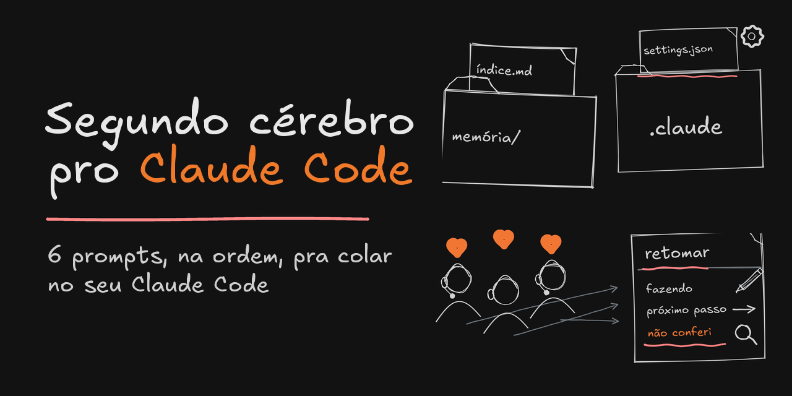
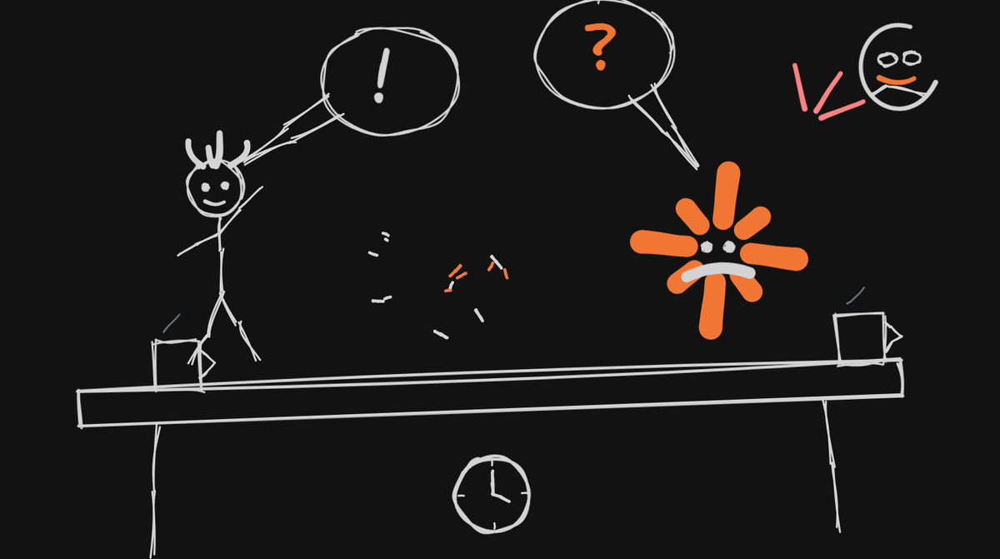
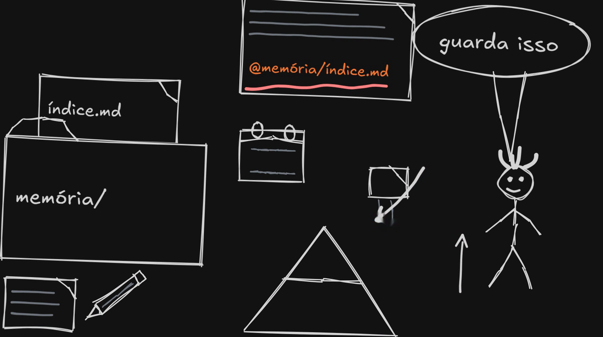
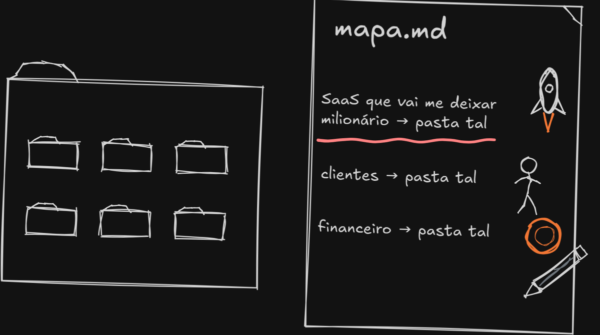
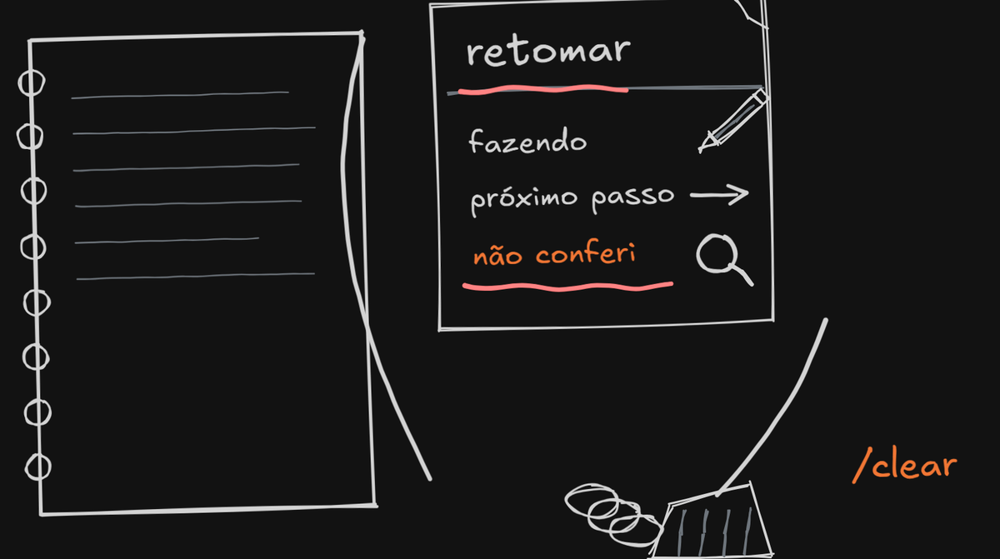
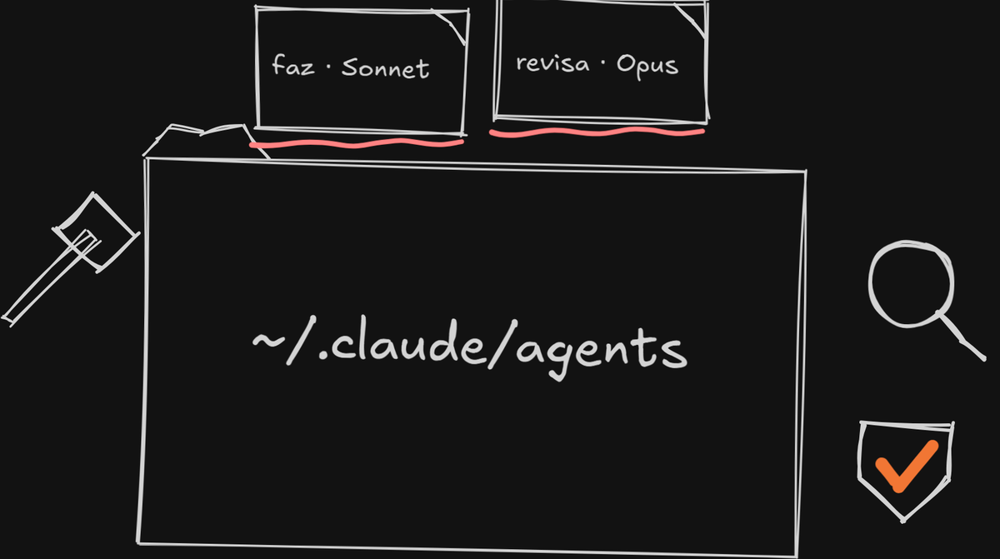
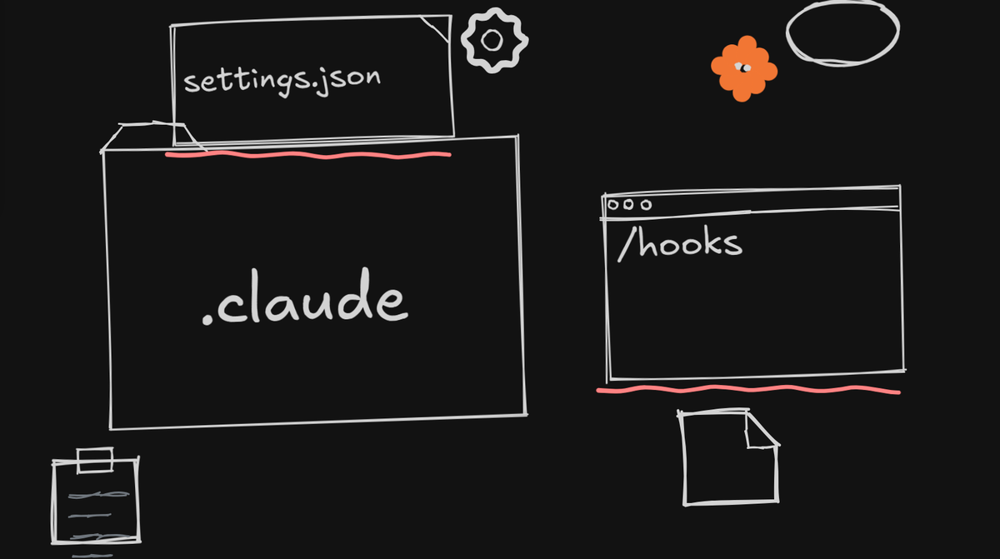
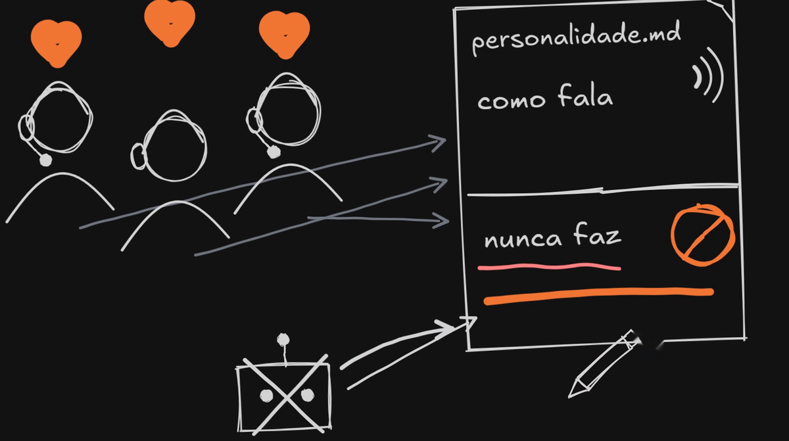

<p align="center"></p>

# Segundo cérebro pro Claude Code

Este repositório tem os 6 prompts que eu uso pra montar um cérebro só meu no Claude Code, usando só uma pasta e uns arquivos de texto: sem Obsidian, sem plugin e sem banco de dados. Eles estão na ordem em que eu monto, cada um num arquivo, prontos pra copiar. Antes do primeiro tem um passo 0, uma entrevista, que serve de base pros dois seguintes.

## Antes de começar

- Tenha o Claude Code instalado e funcionando.
- Faça uma cópia da sua pasta `~/.claude` antes de mexer. Os prompts mexem no `CLAUDE.md` e no `settings.json`, e é bom poder voltar atrás.
- Use um prompt por conversa e na ordem. Cada passo constrói em cima do anterior.
- Cada prompt termina pedindo pro Claude abrir de novo o que ele escreveu e conferir. Depois de cada passo tem uma linha, "Como saber que funcionou", com um teste que você faz numa conversa nova.
- Leia o que o Claude mostrar antes de salvar. Os prompts pedem pra ele mostrar o rascunho primeiro, e é aí que você corrige.
- O que está entre `<` e `>` é com você: troque pelo caminho, pelo nome ou pelo link que é seu.

## Os passos

### 0. A entrevista



Antes de montar qualquer coisa, deixa o Claude te conhecer. Se você pede uma memória ou um mapa sem ele saber quem você é, ele inventa, e você gasta o tempo corrigindo. Aqui é ao contrário: ele pergunta, você responde, e tudo vai pra um arquivo, o `entrevista.md`. A regra é uma pergunta por vez, e ele tem que insistir quando a resposta vier vaga. Os passos 1 e 2 leem esse arquivo pra propor as primeiras memórias e os caminhos do mapa. Você pode rodar a entrevista mais de uma vez, e cada rodada acrescenta ao arquivo.

```
Quero que você me entreviste antes de escrever qualquer coisa. O objetivo é te dar o que você precisa saber sobre mim e sobre o meu trabalho.

Regras da entrevista:
- Uma pergunta por vez. Espere eu responder antes de fazer a próxima.
- Se a resposta vier vaga ("de tudo um pouco", "depende"), insista: peça um exemplo de verdade, um nome, um caminho, um número.
- Cada pergunta e cada resposta vão sendo gravadas, na hora, em ~/.claude/entrevista.md. Se o arquivo já existir, acrescente no fim com a data de hoje, sem apagar o que já está lá.

Os assuntos, nesta ordem:
1. O que eu faço e pra quem.
2. Os meus projetos de agora e o caminho da pasta de cada um.
3. O que eu faço toda semana.
4. O que eu vivo esquecendo ou explicando de novo pra você.
5. Como eu quero que você fale comigo.

Quando eu disser "chega", pare e liste o que você ainda não sabe. Nessa hora não crie memória nem mapa: isso fica pros próximos passos.

Antes de terminar, abra o ~/.claude/entrevista.md de novo e confirme que as perguntas e as respostas estão lá, como combinamos.
```

Este prompt também está em [prompts/00-entrevista.md](prompts/00-entrevista.md).

**Como saber que funcionou:** abra o `~/.claude/entrevista.md` e veja se as suas respostas estão lá, uma abaixo da pergunta.

### 1. A memória



O Claude não lembra de nada de uma conversa pra outra: quando você abre uma nova, ele começa do zero, sem o nome do projeto e sem a correção que você fez ontem. Pra ele, memória é só um texto escrito numa pasta que ele lê. O que funcionou pra mim foi uma memória por arquivo, cada um com um fato só, e um índice com uma linha por memória, pequeno o bastante pra ele ler inteiro toda vez e abrir o resto só quando precisar. Quem decide o que vira memória é você, e quase sempre ela nasce de uma correção.

```
Quero que você passe a ter memória entre conversas, com uma memória por arquivo. Monte assim:

1. Crie a pasta ~/.claude/memoria e, dentro dela, o arquivo indice.md.
2. No ~/.claude/CLAUDE.md, acrescente a linha @~/.claude/memoria/indice.md, pra você ler o índice em toda conversa.
3. Logo abaixo, escreva estas regras:
   - Quando eu te corrigir ou disser "guarda isso", crie um arquivo novo em ~/.claude/memoria com um fato só: a regra, o porquê e a data de hoje.
   - Acrescente no indice.md uma linha apontando pra ele: - [título](arquivo.md) — do que se trata, em uma frase.
   - Antes de criar, veja se já existe um arquivo sobre o assunto. Se existir, atualize esse em vez de criar outro.
   - Se uma memória ficar errada, corrija ou apague, e tire a linha do índice.
   - O índice tem só uma linha por memória. O detalhe fica no arquivo, que você só abre quando precisar.
   - Não guarde o que já está no código nem o que só importa pra esta conversa.

Se existir o arquivo ~/.claude/entrevista.md, leia ele antes e proponha as primeiras memórias a partir das minhas respostas. Eu aprovo uma por uma, e você só cria o arquivo da que eu aprovar.

Me mostre como vai ficar o CLAUDE.md antes de salvar.

Depois de salvar, abra de novo cada arquivo que você escreveu (o CLAUDE.md, o indice.md e as memórias) e confirme que está como combinamos.
```

Este prompt também está em [prompts/01-memoria.md](prompts/01-memoria.md).

**Como saber que funcionou:** numa conversa, diga "guarda isso: <um fato seu>". Abra outra conversa e pergunte sobre ele. O Claude responde sem você repetir, e o `indice.md` tem uma linha nova.

### 2. O mapa



Eu tinha uma pasta pra cada projeto e abria o terminal dentro de cada uma. O que resolveu foi um arquivo que eu chamo de mapa: ele não guarda fato nenhum, só diz onde cada coisa mora, como a placa de um shopping. Com ele você abre o terminal sempre na pasta de cima, e de lá o Claude chega em qualquer projeto sem sair procurando. Eu medi: fiz as mesmas três perguntas sobre o meu trabalho antes e depois do mapa. Antes ele levou 305 segundos e leu 870 mil tokens pra responder as três. Depois levou 53 segundos e leu 448 mil, e acertou as três.

```
Todos os meus projetos ficam em <caminho da pasta de cima>. Quero que você chegue em qualquer um deles a partir dessa pasta, sem sair procurando.

1. Liste as pastas que estão lá dentro e me mostre um rascunho do MAPA.md, com uma linha por lugar: o que é e o caminho. Exemplo: "Clientes da agência: <caminho>/agencia". Se existir o arquivo ~/.claude/entrevista.md, use os caminhos que eu dei lá no rascunho. Eu corrijo os nomes antes de você salvar.
2. Salve o MAPA.md em <caminho da pasta de cima>. O mapa não guarda fato nenhum, só diz onde cada coisa mora.
3. No ~/.claude/CLAUDE.md, acrescente duas regras:
   - Pra qualquer coisa fora do projeto em que você está, comece pelo mapa: <caminho da pasta de cima>/MAPA.md.
   - Quando alguma coisa mudar de lugar, atualize a linha do mapa na mesma hora.
   - Toda vez que você usar o mapa e um caminho não existir mais, me avise e corrija a linha na hora.
4. Depois de salvar, confira que cada caminho do MAPA.md existe de verdade e me diga quais não existem. Abra também o CLAUDE.md de novo e confirme que as regras estão lá.

Daqui pra frente eu abro o terminal sempre nessa pasta de cima.
```

Este prompt também está em [prompts/02-mapa.md](prompts/02-mapa.md).

**Como saber que funcionou:** abra uma conversa nova na pasta de cima e pergunte onde fica um dos seus projetos. Ele responde pelo mapa, sem sair procurando.

### 3. Virar a página



Como o Claude relê a conversa inteira a cada mensagem, conversa grande custa mais e rende menos. A minha regra é virar a página quando ela passa de 300 mil tokens ou quando eu troco de assunto: ele escreve num arquivo o que a gente estava fazendo, qual é o próximo passo e o que ele ainda não conferiu, e você dá um /clear. A parte do que ele não conferiu é a que importa, porque o Claude da conversa nova acredita em tudo o que está escrito ali.

```
Coloque no ~/.claude/CLAUDE.md uma regra chamada "Virar a página":

Quando eu disser "vira a página", quando eu trocar de assunto ou quando a conversa passar de 300 mil tokens, escreva o arquivo <caminho>/retomar.md com:
- o que a gente estava fazendo;
- o próximo passo;
- os arquivos envolvidos;
- o que espera decisão minha;
- uma seção "Não conferi", com tudo o que veio de cabeça e não foi lido nem testado agora (se não tiver nada, escreva "nada").

O retomar cabe numa página e traz tudo o que ainda está pendente, porque cada versão substitui a anterior. Depois de escrever, me peça pra digitar /clear.

Quando uma conversa nova começar com "retoma", leia o retomar.md antes de qualquer coisa. O que estiver em "Não conferi" é suspeita, não fato: confira antes de usar.

Depois de salvar a regra, abra o ~/.claude/CLAUDE.md de novo e confirme que ela está lá, com os cinco itens do retomar.
```

Este prompt também está em [prompts/03-virar-a-pagina.md](prompts/03-virar-a-pagina.md).

**Como saber que funcionou:** diga "vira a página". Ele escreve o `retomar.md` e pede o `/clear`. Depois do `/clear`, comece a conversa com "retoma".

### 4. O maestro e os dois agentes



Quando o trabalho é grande, como ler cinquenta arquivos ou rodar uma bateria de testes, fazer isso na conversa principal enche ela de coisa. Então a conversa principal virou um maestro: ela conversa com você, decide e confere, e manda o trabalho pesado pra outro agente. Um modelo mais barato faz, o mais caro revisa, e o que mexe com segurança, senha ou dinheiro continua com o mais caro fazendo. Eu testei em três tarefas de programação que antes o Opus tinha feito inteiras: com o Sonnet fazendo e o Opus revisando, os agentes custaram 12,82 dólares, contra 24,05 do jeito antigo, quase metade. Um dos três valores é aproximado, porque encerrei a medição antes de fechar a conta daquela tarefa.

```
Quero que esta conversa vire o maestro: ela conversa comigo, decide e confere, e o trabalho pesado vai pra outros agentes.

1. Crie dois subagentes em ~/.claude/agents:
   - executor.md (model: sonnet): faz o trabalho pesado a partir de um pedido completo (ler muitos arquivos, implementar, rodar testes). Não muda o pedido por conta própria. Devolve só um resumo de até 10 linhas: o que fez, o resultado dos testes e onde estão os detalhes.
   - revisor.md (model: opus): revisa o que o executor entregou, sem mudar nada: se está certo, se é seguro, os casos de borda e os testes. Termina com um veredito (Aprovado, Aprovado com detalhes ou Precisa de correção) e cada problema com arquivo e linha.
2. No ~/.claude/CLAUDE.md, escreva a regra do maestro:
   - Coisa pequena você faz aqui mesmo. Trabalho pesado vai pro executor, com o pedido completo, porque ele não vê esta conversa.
   - Toda entrega passa pelo revisor antes de você me dizer que está pronto.
   - O que mexe com segurança, senha ou dinheiro, o executor faz com o Opus (model: opus no despacho).
   - Correção vai pra um executor novo, junto com o relatório do revisor.

Me mostre os dois arquivos e a regra antes de salvar.

Depois de salvar, abra de novo o executor.md, o revisor.md e o CLAUDE.md e confirme que cada um está como combinamos, inclusive o model de cada agente.
```

Este prompt também está em [prompts/04-maestro.md](prompts/04-maestro.md).

**Como saber que funcionou:** peça uma tarefa grande. Ele manda o executor e depois o revisor, e o `/agents` lista os dois.

### 5. Os hooks



Quase tudo o que veio até aqui depende de alguém lembrar de fazer. O hook é um programinha que o próprio Claude Code roda sozinho em certas horas, e o que ele escreve entra na conversa. Com ele a regra para de depender da memória de alguém, porque o Claude Code roda o hook toda vez, mesmo quando os dois esquecem. Cuidado só com o tamanho do que ele escreve, porque isso é relido a cada mensagem.

```
Quero dois hooks no Claude Code. Antes de mexer, faça uma cópia do ~/.claude/settings.json e me mostre o que vai mudar.

1. O teto (evento Stop): um script em Python que lê o JSON da entrada, abre o arquivo do transcript_path, pega o usage da última resposta e soma input_tokens, cache_creation_input_tokens e cache_read_input_tokens. Se passar de 300 mil, responde {"decision": "block", "reason": "A conversa passou de 300 mil tokens. Vire a página: escreva o retomar e me peça /clear."}. Depois disso, só avisa de novo a cada 100 mil a mais (guarde o último aviso num arquivo com o session_id). Se a entrada vier com stop_hook_active verdadeiro, ou se der qualquer erro, ele sai sem dizer nada.
2. O lembrete (evento UserPromptSubmit): um script que imprime a data e a hora do meu PC e um lembrete de no máximo três linhas com as regras que eu mais quero que você siga numa conversa longa. Me pergunte quais são essas regras antes de escrever. Tudo o que ele imprime é relido a cada mensagem, então tem que ser curto.

Teste os dois rodando cada script à mão com um JSON de exemplo, e me diga como conferir em /hooks.

Depois de salvar, abra de novo o settings.json e os dois scripts e confirme que os dois hooks estão registrados, com o caminho certo de cada script.
```

Este prompt também está em [prompts/05-hooks.md](prompts/05-hooks.md).

**Como saber que funcionou:** o `/hooks` mostra os dois, e a sua próxima mensagem chega com a data e a hora.

### 6. A personalidade



Esse não estava na minha lista, mas deixa trabalhar com ele bem mais divertido. No fim também é só um arquivo, lido no começo de toda conversa: você escolhe duas ou três pessoas que gosta de ouvir, o Claude estuda o jeito delas e escreve numa página como esse parceiro fala e o que ele nunca faz. A parte do que ele nunca faz é a que mais trabalha, porque cada vez que ele soar robô, você acrescenta uma linha.

```
Quero dar uma personalidade pra você. As pessoas que eu gosto de ouvir são:
- <nome 1>: <link do canal, do Substack ou arquivo com textos>
- <nome 2>: <link ou arquivo>
- <nome 3, se tiver>: <link ou arquivo>
O nome desse parceiro vai ser <nome>.

1. Estude o material de cada um e me mostre, com trechos curtos, como cada um fala: o tamanho da frase, as palavras de conversa, como explica uma ideia difícil, como faz humor.
2. Escreva ~/.claude/personalidade.md, com no máximo uma página e duas partes:
   - "Como fala": o jeito, com um exemplo curto de cada traço.
   - "O que nunca faz": os vícios de robô que eu não quero ver (frase de efeito, lista pra tudo, resumo no fim, elogio à pergunta).
   Pegue o jeito deles, mas não copie bordão nem piada.
3. No ~/.claude/CLAUDE.md, acrescente @~/.claude/personalidade.md, pra você ler em toda conversa.
4. Daqui pra frente, quando eu disser que você soou robô, acrescente uma linha em "O que nunca faz" com o exemplo.

Depois de salvar, abra de novo o personalidade.md e o CLAUDE.md e confirme que o arquivo tem as duas partes e que a linha @ está no CLAUDE.md.
```

Este prompt também está em [prompts/06-personalidade.md](prompts/06-personalidade.md).

**Como saber que funcionou:** diga "soou robô". Aparece uma linha nova em "O que nunca faz" no `personalidade.md`.

## Como fica no fim

Depois dos 6 passos, a sua pasta `~/.claude` fica mais ou menos assim:

```
~/.claude/
├── CLAUDE.md             as regras, com o índice, o mapa e a personalidade
├── settings.json         onde moram os hooks
├── personalidade.md      como o parceiro fala e o que ele nunca faz
├── entrevista.md         as suas respostas do passo 0 (cada rodada acrescenta)
├── memoria/
│   ├── indice.md         uma linha por memória
│   └── ...               um arquivo por fato
├── agents/
│   ├── executor.md       faz o trabalho pesado (Sonnet)
│   └── revisor.md        confere o que foi feito (Opus)
└── (os dois scripts dos hooks, onde o Claude os colocar)
```

E na pasta onde ficam todos os seus projetos:

```
<pasta de cima>/
├── MAPA.md               onde cada coisa mora
├── retomar.md            o que a gente estava fazendo (cada versão substitui a anterior)
└── ...                   os seus projetos
```

## Licença

MIT, em nome de Heverson Silva. Veja o arquivo [LICENSE](LICENSE).
